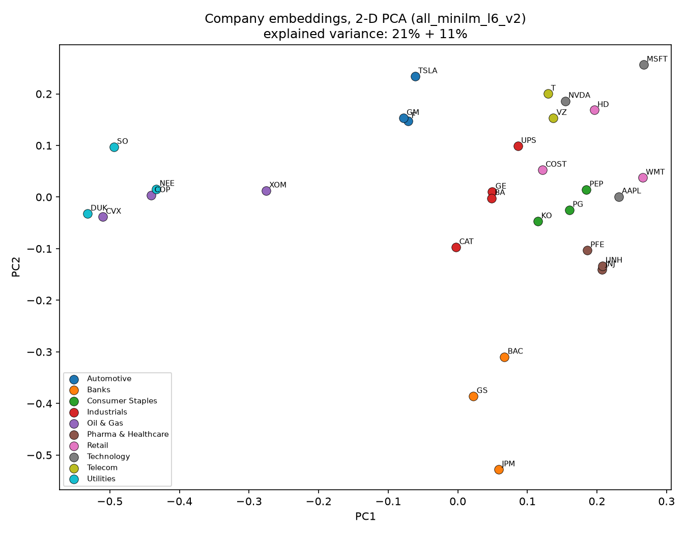
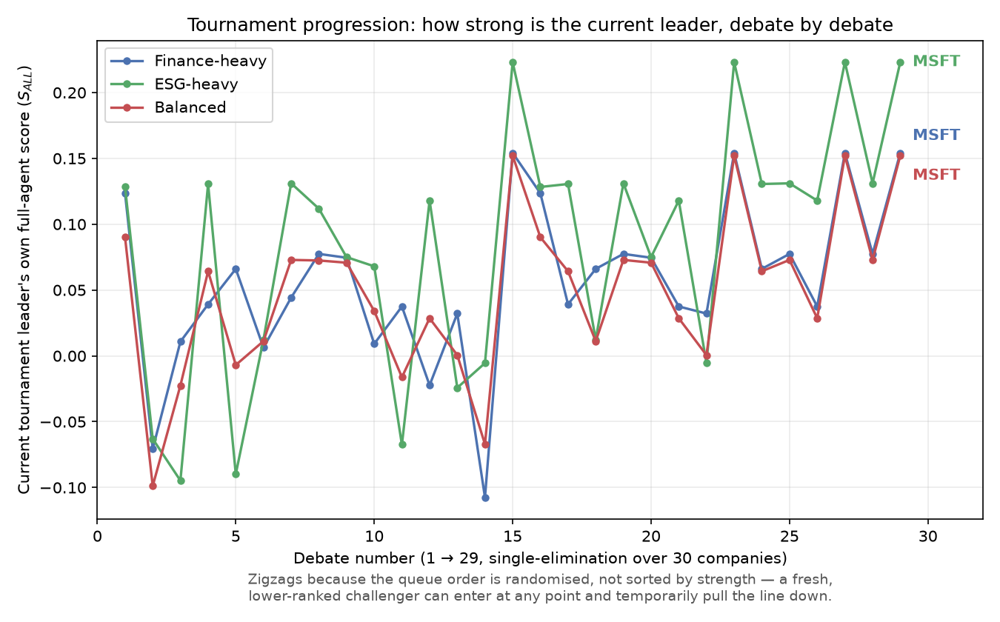
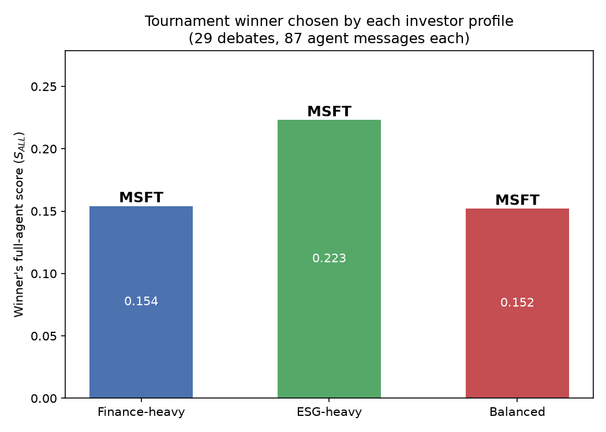
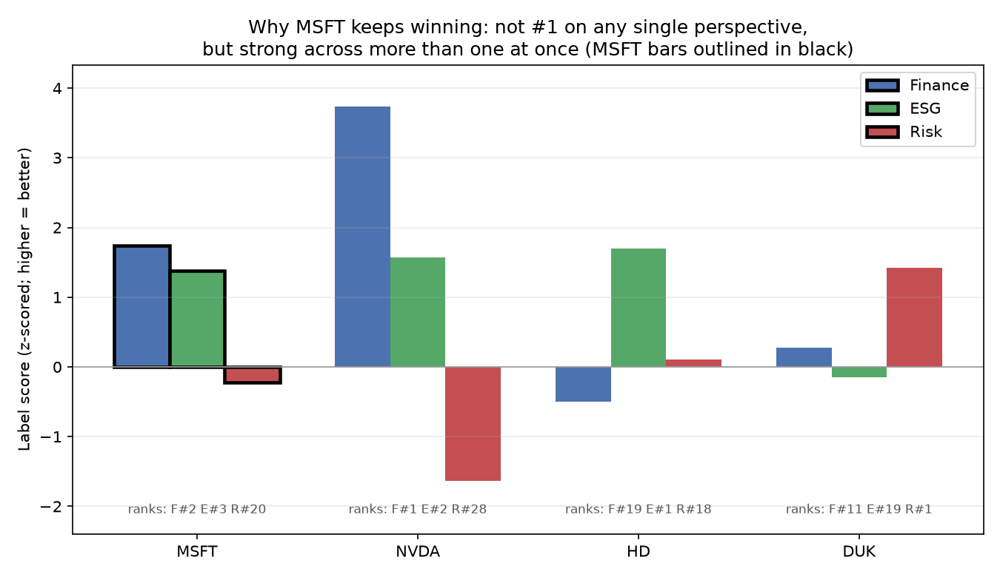
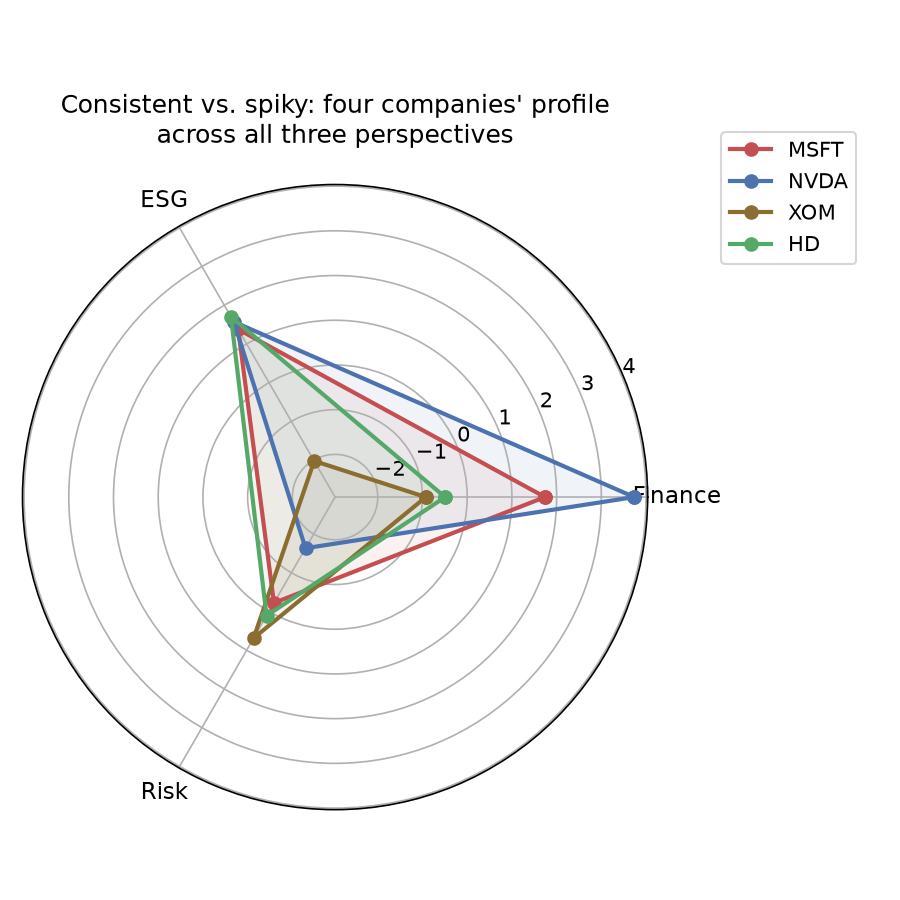
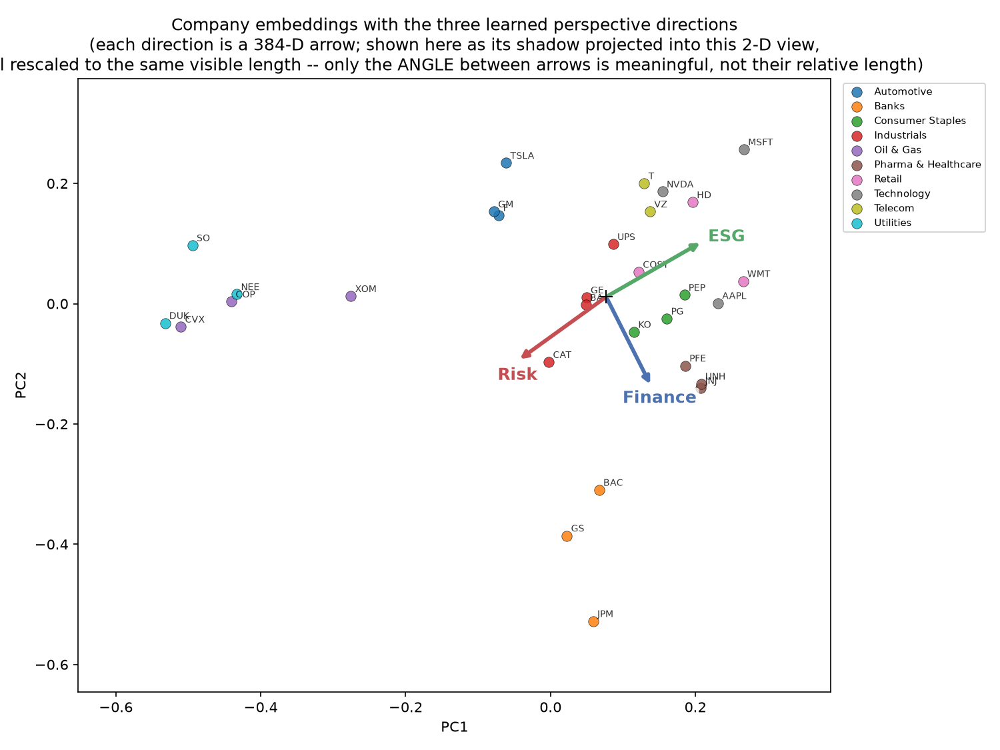
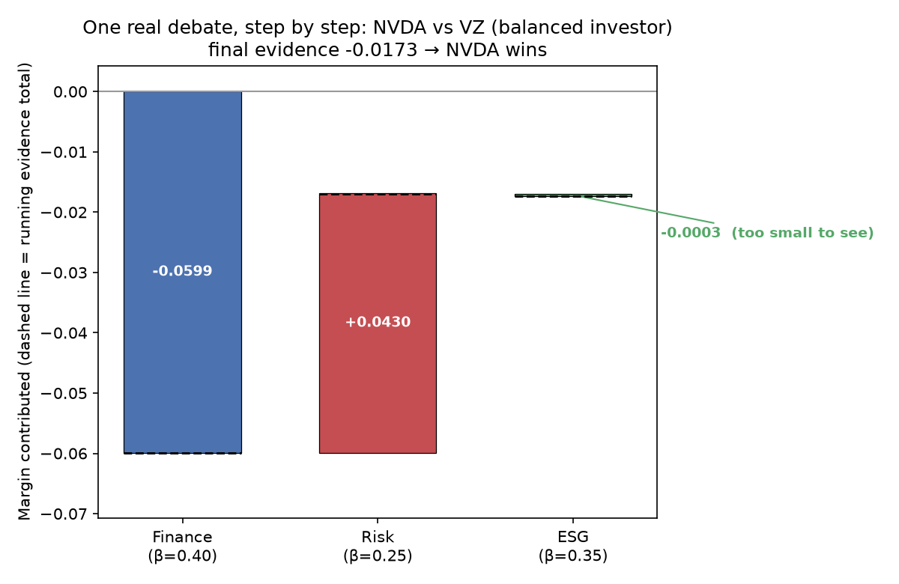
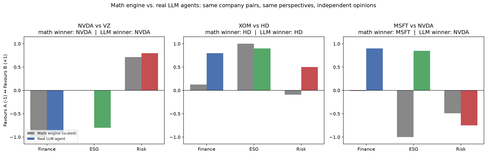

# Company Debate: When Do Partial-Information Agents Converge to a Full-Information Debate?

**Ishwarya Mohan**¹, under the supervision of **Prof. Mahesh Mohan M R**¹ and **Kunal**¹
¹ Indian Institute of Technology Kharagpur

*Working research, part of the "Financial Agentic AI Debate" project. This repository accompanies an
internal research brief (8 Oct 2026) and is not yet a formal publication — see [Status](#status) and
[Citation](#citation).*

📄 [EXPLAIN.md](reports/EXPLAIN.md) — plain-language walkthrough &nbsp;·&nbsp;
📊 [RESULTS.md](reports/RESULTS.md) — full results with sources &nbsp;·&nbsp;
📓 [PROGRESS.md](PROGRESS.md) / [DECISIONS.md](DECISIONS.md) — reproducibility log

---

## Abstract

We study a multi-agent debate setting for company selection in which three perspective agents —
**Finance**, **ESG**, and **Risk** — each observe a company only through a single learned direction in
embedding space, while a reference *full agent* observes all three directions jointly, weighted by an
investor's stated preferences. We show that when agent scores are linear in a shared embedding, the
debate's outcome is provably identical to the full agent's ranking once every agent has spoken — an
algebraic identity, not an empirical finding. We instead use this identity as a correctness check and
study three regimes where the guarantee is no longer trivial: (i) **noisy** agent evidence, where the
full 3-agent debate is consistently more accurate than majority voting; (ii) a **missing** agent, whose
damage scales with that agent's weight in the investor's preferences; and (iii) **early stopping**,
where a provably valid bound on undisclosed evidence saves up to one third of agent messages for
concentrated investor preferences and none for diffuse ones. We instantiate and test this framework on
**30 real US-listed companies**, embedding their actual SEC 10-K filings with a pretrained sentence
encoder, learning each perspective direction from real financial, ESG, and market-risk labels with
held-out (company-level) cross-validation, and verifying the core identity on every debated pair with
zero violations.

<p align="center"></p>
<p align="center"><sub>Figure 1. Companies embedded from SEC 10-K text and projected to 2-D (PCA);
colour = sector. Same-sector companies cluster together far above a random baseline (§4.1).</sub></p>

---

## 1. Introduction

Multi-agent LLM debate has been proposed as a way to improve reasoning by having models critique one
another. A less-examined question is *informational*: what happens when the agents debating do not all
have access to the same information? We study this in a company-selection setting motivated by
investment decision-making, where a Finance analyst, an ESG analyst, and a Risk analyst each have
genuine, non-overlapping expertise, and a portfolio manager (the investor) must weigh their input.

We formalise "expertise" as a single direction in a shared embedding space (Def. 1–2, §2), and show that
the debate-vs-full-agent agreement result is a direct consequence of linearity (§2.3), not a property
that needs to be demonstrated empirically — the interesting questions are instead what breaks this
equivalence, and by how much (§2.4, §4.3).

## 2. Method

### 2.1 Company representation

Each company $i$ is represented by an embedding $z_i \in \mathbb{R}^d$ ($d=384$), obtained by encoding
its SEC 10-K Risk Factors section with a pretrained sentence encoder
(`sentence-transformers/all-MiniLM-L6-v2`), chunking to respect the model's context window, mean-pooling
chunk vectors, and L2-normalising. Before chunking, each filing's extracted text is cleaned: lines
consisting only of a bare page number or a "Table of Contents" marker — artefacts of converting the
original filing to plain text — are dropped, and remaining lines are joined into a single continuous
block (`p04_embed.py:clean`). See §5 for a real side effect of this rule found during inspection.

### 2.2 Perspective directions and the full agent

For perspective $k \in \{F, E, R\}$ (Finance, ESG, Risk), we learn a unit direction $d_k$ by fitting an
L2-regularised logistic classifier on company **pairs**, with target "does company $a$ score higher than
company $b$ on perspective $k$" and feature $z_a - z_b$ (Def. 2). An investor is a weight vector
$\beta = (\beta_F, \beta_E, \beta_R)$, $\beta_k \ge 0$, $\sum_k \beta_k = 1$. The **full agent**'s
direction and score are

$$d_{\text{ALL}} = \sum_k \beta_k\, d_k \qquad\qquad S_{\text{ALL}}(i) = z_i \cdot d_{\text{ALL}}$$

while **partial agent** $k$ knows only $\beta_k d_k$ — in particular, none of the three partial agents
individually knows $d_{\text{ALL}}$ or $S_{\text{ALL}}$.

### 2.3 The debate, and why it must agree with the full agent

For a pair $(A, B)$, agent $k$'s margin is $m_k = \beta_k\,(\Delta z \cdot d_k)$ where
$\Delta z = z_B - z_A$. Agents speak in turn — highest-weight agent first, then at each subsequent step
the *strongest challenger* of the previous speaker, defined as $\arg\min_j G_{kj}$ among agents who
have not yet spoken, where $G_{kl} = \cos(d_k, d_l)$ is the inter-agent **agreement matrix** — and the
sign of the cumulative "running evidence" after all agents have spoken decides the winner. Because
$d_{\text{ALL}}$ is a $\beta$-weighted sum of the $d_k$, this quantity is, by construction, identical to
the full agent's score gap:

$$m_F + m_E + m_R \;=\; \Delta z \cdot d_{\text{ALL}} \;=\; S_{\text{ALL}}(B) - S_{\text{ALL}}(A)$$

so **the debate winner equals the full-agent winner whenever all agents have spoken** — a property of
linear scoring, independent of speaker order. We verify this identity automatically on every debated
pair (§4.3; zero violations across all runs) and use it as a correctness test for the implementation,
not as the paper's finding.

### 2.4 Where the identity breaks: noise, missing agents, early stopping

Three departures from the clean setting make the comparison non-trivial, and are where we report actual
empirical results (§4.4):

- **Noise.** Each margin is perturbed by $\mathcal{N}(0, \sigma^2)$ before the debate decides; we
  compare the resulting mismatch rate against the full-agent winner to the mismatch rate of a simple
  majority vote under the same noise.
- **A missing agent.** One perspective is dropped entirely (its margin is never heard); $\beta$ is
  renormalised over the remaining two.
- **Early stopping.** A debate halts once a provable bound on the undisclosed agents' combined margin
  — derived from $\|\Delta z\|$, the spoken margins, and $G$ — guarantees the sign cannot flip (three
  bounds of increasing tightness are compared; see `engine.py:_bounds`).

### 2.5 Tournament

Given a candidate set, companies are paired from a queue, the loser of each debate is eliminated, and
the winner rejoins the back of the queue, until one company remains (a standard single-elimination
queue tournament).

## 3. Experimental setup

**Companies.** 30 US-listed companies across 10 sectors (Technology, Oil & Gas, Banks, Utilities,
Retail, Pharma & Healthcare, Consumer Staples, Industrials, Automotive, Telecom), selected to induce
genuine disagreement between perspectives (e.g. energy majors score well on Finance, poorly on ESG).

**Labels.** Finance = z-scored blend of 3-year revenue CAGR and operating/pretax margin (Yahoo Finance).
ESG = Sustainalytics Total ESG Risk score, sign-flipped (Kaggle snapshot, 2024-06-07 — the only free
source found with full coverage; Yahoo Finance's live ESG field was empty for every company tested).
Risk = z-scored blend of annualised volatility and maximum drawdown over 3 years of daily prices
(Yahoo Finance), sign-flipped so higher is safer. All three winsorised at $\pm2.5\sigma$.

**Text.** SEC 10-K Item 1 (Business) and Item 1A (Risk Factors), extracted directly from EDGAR filings
(heading-based extraction with fallbacks for non-standard filers; see `DECISIONS.md`).

**Evaluation protocol.** Direction quality is evaluated with **company-level** (not pair-level) nested
cross-validation — holding out whole companies prevents a held-out company's embedding from leaking into
training via other pairs. Regularisation strength is selected by an inner cross-validation on the
training fold only.

**Investors.** Three preset weight profiles (`finance_heavy`, `esg_heavy`, `balanced`); an interactive
18-question pairwise elicitation tool is implemented (`p06_investor.py --interview`) but not yet
administered to a human subject (§5).

## 4. Results

### 4.1 Embedding quality

Nearest-neighbour same-sector rate (cosine similarity), vs. a random baseline of 7.1%:

| Variant | top-1 same-sector | top-3 same-sector |
|---|---|---|
| Item 1A (Risk Factors) | 76.7% | 50.0% |
| Item 1 (Business) | 93.3% | 62.2% |
| Both | 93.3% | 55.6% |

### 4.2 Direction fit (held-out, company-level CV)

| Perspective | Pair accuracy | Spearman $\rho$ | Sector-only baseline (accuracy) |
|---|---|---|---|
| Finance | **0.862** $\pm$ 0.030 | 0.613 | 0.822 |
| ESG | **0.840** $\pm$ 0.052 | 0.732 | 0.730 |
| Risk | **0.748** $\pm$ 0.044 | 0.452 | 0.641 |

All three exceed chance (0.5) and their respective sector-only baseline, though for ESG the margin is
small — at $n=30$ companies, a non-trivial share of what each direction learns is attributable to sector
membership rather than finer distinctions (sector explains 55–73% of in-sample label variance; full
table in RESULTS.md §4).

Learned agreement matrix $G = \cos(d_k, d_l)$:

$$G = \begin{pmatrix} 1.00 & +0.19 & +0.14 \\ +0.19 & 1.00 & -0.16 \\ +0.14 & -0.16 & 1.00 \end{pmatrix}
\begin{matrix}F\\E\\R\end{matrix}$$

ESG and Risk are the only natural challengers (negative $G$); Finance correlates mildly positively with
both — different from the illustrative values on the originating whiteboard, which were not derived
from data (see EXPLAIN.md §5).

### 4.3 Debate correctness

The identity $m_F+m_E+m_R = S_{\text{ALL}}(B)-S_{\text{ALL}}(A)$ was checked automatically on every
debated pair across all tournaments and all three investors: **zero violations**. The tournament winner
matched the full-agent top-ranked company for every investor tested. All investors converged on the
same overall winner (MSFT) in this company set — but their complete 30-company rankings correlate at
only $\rho = 0.57$ (finance-heavy vs. esg-heavy), indicating materially different preferences that
happened to coincide at rank 1 (full correlation matrix in RESULTS.md §7).

<p align="center"></p>
<p align="center"><sub>Figure 2. Each investor's single-elimination tournament over all 30 companies —
29 debates, 87 agent messages, per investor (§3). The line tracks the <em>currently undefeated</em>
company's own full-agent score after each debate; it zigzags because the elimination queue is
randomised, not sorted by strength, so a weak challenger can enter and briefly pull the line down
before being eliminated itself. All three converge to MSFT, but via different paths — different
debates, different near-misses along the way.</sub></p>

<p align="center"></p>
<p align="center"><sub>Figure 3. The company each investor's tournament ends on, and that company's
own full-agent score under that investor's weights. Same winner (MSFT) for all three here — but note
the ESG-heavy investor scores its winner noticeably higher (0.223) than the other two (0.152–0.154),
since MSFT's strong ESG profile is worth more to an investor who weights ESG at 70%.</sub></p>

### 4.3.1 Opening up the mechanism

The plots above show *outcomes*. These four show *why* — the actual numbers underneath, not just who won.

<p align="center"></p>
<p align="center"><sub>Figure 4. MSFT isn't #1 on any single perspective (Finance #2, ESG #3, Risk #20)
— but it's the only company in this set that's strong on more than one at once. NVDA is the Finance
leader but has the worst Risk score of all 30; HD and DUK are each a one-trick pony on a different
axis. Consistency, not dominance, is what wins a weighted-sum tournament.</sub></p>

<p align="center"></p>
<p align="center"><sub>Figure 5. The same idea as a shape: MSFT's profile is the most rounded of the
four; NVDA, XOM and HD are each spiky on one axis and collapse on another.</sub></p>

<p align="center"></p>
<p align="center"><sub>Figure 6. The 384-dimensional Finance/ESG/Risk directions, projected into the
same 2-D view as the company embeddings (arrows rescaled to equal length — only the <em>angle</em>
between them is meaningful here, not their length; see §4.2's real, un-rescaled $G$ matrix for that).
Risk and ESG point in noticeably different directions from Finance, visually matching $G$'s negative
Risk&ndash;ESG entry.</sub></p>

<p align="center"></p>
<p align="center"><sub>Figure 7. One real pair debate (NVDA vs. VZ, balanced investor), as a waterfall:
each bar is one agent's margin, the dashed line is the running evidence total after that agent speaks.
Finance's strong vote for NVDA (−0.0599) is partly offset by Risk favouring VZ (+0.0430); ESG's
contribution here is genuinely negligible (−0.0003) — NVDA wins on the strength of Finance and Risk
roughly cancelling in its favour, not because of ESG.</sub></p>

### 4.4 Stress tests

**Noise.** The full 3-agent debate is more robust to additive noise on the margins than majority voting
at every noise level tested, for every investor (e.g. balanced investor, $\sigma=0.05$: debate mismatch
rate 0.216 vs. majority-vote 0.277; full curves in `outputs/stress_noise_*.png`).

**Missing agent.** Winner-flip rate scales roughly with the dropped agent's $\beta$ weight (balanced
investor: dropping ESG, $\beta_E=0.35$, flips 30.0% of pairs; dropping Risk, $\beta_R=0.25$, flips
5.8%).

**Early stopping.** The tightest bound saves 19–33% of agent messages for concentrated investors
(finance-heavy, esg-heavy) and 0% for the balanced investor, whose weights are too close together for
the running evidence to lock in before all agents speak — and, consistent with the bound being
provably valid, **zero winner mismatches were observed under early stopping across all conditions
tested** (also verified on 600 synthetic random-world pairs in `tests/test_engine.py`).

### 4.5 LLM-based debate: real agents, real text

Everything above runs the debate as arithmetic: an agent's "opinion" is one dot product, agents never
see each other, and the identity in §2.3 holds because addition commutes. `src/llm_debate.py` asks a
different question — what happens with the *same* three perspectives (Finance, ESG, Risk), but each one
is a real language model call instead of a number? Concretely: each agent is a system prompt restricting
it to its one perspective, shown the company's *real* underlying figures (revenue CAGR, profit margin,
ESG risk score, volatility, drawdown — not an embedding), and asked for a verdict and a confidence score
in $[-1,+1]$. Unlike the math engine, each agent also sees the **full text** of every agent that spoke
before it, so real revision is possible, and nothing here guarantees order-independence — this is a
genuinely different mechanism, run on 3 pairs (NVDA–VZ, XOM–HD, MSFT–NVDA) via Groq
(`openai/gpt-oss-20b`), not a reimplementation of the math engine.

<p align="center"></p>
<p align="center"><sub>Figure 8. Same company pairs, same three perspectives, two independent ways of
forming an opinion: the math engine's margin (grey, rescaled to $\pm1$ for comparability) against the
real LLM agent's own stated confidence (coloured). NVDA–VZ and XOM–HD: both methods agree on every
agent's direction and on the overall winner. MSFT–NVDA: they disagree.</sub></p>

The MSFT–NVDA disagreement is the interesting result, and it is explainable from the real numbers, not
noise. On **Finance**, the math engine's margin is essentially a coin flip ($-0.0005$) — but NVDA's real
3-year revenue CAGR is $+100\%$ against MSFT's $+16.1\%$, and its profit margin is $60.4\%$ against
$46.8\%$; the LLM agent, reading those numbers directly, calls it decisively for NVDA (confidence
$+0.9$). On **ESG**, the math engine's direction favours MSFT ($-0.0413$), but the *actual*
Sustainalytics risk scores say NVDA is lower-risk ($13.6$ vs. MSFT's $15.1$, lower is better) — the
LLM, given the real score, favours NVDA just as decisively, and the embedding-learned direction gets
this one pair backwards. Only **Risk** agrees: both methods favour MSFT (real volatility $26.3\%$ vs.
$46.8\%$), consistent with real numbers either way.

This is not a failure of the math engine in general — §4.2 already reports its held-out pair accuracy
honestly (74.8–86.2%, not 100%) — it is a concrete instance of exactly that: a direction fit once across
all 30 companies is a statistical approximation, and on any *specific* pair it can miss a gap that is
obvious once you read the real numbers for just those two companies. The LLM agent has no such
approximation step; it is handed the literal figures for exactly the two companies being compared. Full
transcripts: `outputs/llm_debate_{NVDA_vs_VZ,XOM_vs_HD,MSFT_vs_NVDA}.json`; comparison code:
`src/p11_llm_insights.py`.

## 5. Limitations

- Scale: 30 companies, 3 agents, 2 debate rounds per pair — a first instantiation of the framework, not
  matched to any particular target scale.
- The ESG label is a static 2024 snapshot while Finance and Risk are pulled at run time; a genuine
  temporal mismatch, not reconciled.
- Perspective directions are assumed shared across all investors (only $\beta$ varies) — this follows
  the originating research brief but has not been independently validated.
- The investor-elicitation tool has not yet been administered to a human subject; all reported investors
  are hand-specified presets.
- No comparison yet against a learned (rather than hand-derived) early-stopping bound, or against more
  than three agents.
- **The page-number-stripping rule in text cleaning (§2.1) also removes some legitimate content.**
  Checked directly across all 30 companies: in Bank of America's Business section, a workforce-
  demographics table (e.g. "Women 50%", "Men 42%") gets flattened to one number per line when the
  filing's HTML is converted to plain text — and those bare 1–3 digit numbers match the same pattern as
  real page numbers, so they get silently dropped too. Surrounding sentences and structure are
  unaffected; only a handful of standalone numeric values are lost in this one section. Not expected to
  materially change an embedding built from sentence-level meaning, but a real, found-not-assumed
  limitation of a simple cleaning rule, reported rather than quietly left out.

Full discussion, including every default chosen and why: [DECISIONS.md](DECISIONS.md).

## Appendix A: Full dataset

Raw values behind every company's Finance/ESG/Risk label — the exact content of `data/labels.csv`
joined with `data/companies.csv`, before z-scoring or winsorising. Nothing here is estimated; every
column has a named source.

| Ticker | Sector | 3y Rev CAGR | Margin | Margin basis | ESG risk score | ESG controversy | Volatility (ann.) | Max drawdown |
|---|---|---:|---:|---|---:|---|---:|---:|
| AAPL | Technology | 1.8% | 32.0% | operating | 17.2 | Significant | 26.8% | −33.4% |
| MSFT | Technology | 16.1% | 46.8% | operating | 15.1 | Significant | 26.3% | −34.5% |
| NVDA | Technology | 100.0%¹ | 60.4% | operating | 13.6 | Moderate | 46.8% | −36.9% |
| XOM | Oil & Gas | −6.7% | 10.5% | operating | 41.6 | Significant | 23.2% | −20.1% |
| CVX | Oil & Gas | −7.9% | 9.0% | operating | 36.6 | Significant | 23.1% | −20.8% |
| COP | Oil & Gas | −9.1% | 19.2% | operating | 33.9 | Moderate | 29.2% | −36.3% |
| JPM | Banks | 12.5% | 39.9% | pretax² | 29.3 | Significant | 23.1% | −24.4% |
| BAC | Banks | 6.0% | 33.3% | pretax² | 28.3 | Significant | 24.7% | −27.5% |
| GS | Banks | 7.2% | 37.5% | pretax² | 25.5 | Moderate | 29.8% | −30.9% |
| NEE | Utilities | 9.4% | 29.3% | operating | 23.3 | Moderate | 25.7% | −23.8% |
| DUK | Utilities | 3.9% | 26.6% | operating | 27.0 | Moderate | 16.6% | −13.7% |
| SO | Utilities | 0.3% | 24.7% | operating | 33.0 | Moderate | 17.5% | −15.5% |
| WMT | Retail | 5.3% | 4.2% | operating | 25.3 | Significant | 23.3% | −23.3% |
| COST | Retail | 6.6% | 3.8% | operating | 23.3 | Significant | 20.4% | −20.7% |
| HD | Retail | 1.5% | 12.7% | operating | 12.6 | Moderate | 23.2% | −31.7% |
| JNJ | Pharma & Health | 5.6% | 27.2% | operating | 24.0 | High | 18.4% | −14.4% |
| PFE | Pharma & Health | −14.8% | 27.8% | operating | 24.6 | Significant | 24.2% | −29.0% |
| UNH | Pharma & Health | 11.4% | 4.2% | operating | 15.3 | Significant | 36.9% | **−61.4%**³ |
| PG | Consumer Staples | 2.0% | 22.7% | operating | 28.6 | Significant | 18.0% | −21.2% |
| KO | Consumer Staples | 3.7% | 31.1% | operating | 21.6 | Significant | 16.4% | −15.5% |
| PEP | Consumer Staples | 2.8% | 14.4% | operating | 22.1 | Significant | 20.0% | −27.5% |
| CAT | Industrials | 4.4% | 16.5% | operating | 36.2 | High | 32.8% | −34.0% |
| GE | Industrials | 16.3% | 18.9% | operating | 40.5 | Significant | 31.3% | −21.4% |
| BA | Industrials | 10.3% | −6.1% | operating | 39.6 | High | 34.8% | −48.3% |
| UPS | Industrials | −4.0% | 8.9% | operating | 18.6 | Moderate | 29.6% | −44.2% |
| TSLA | Automotive | 5.2% | 5.1% | operating | 25.2 | Significant | **58.1%**⁴ | −53.8% |
| F | Automotive | 5.8% | −4.9% | operating | 22.4 | Significant | 36.4% | −36.5% |
| GM | Automotive | 5.7% | 1.6% | operating | 28.5 | High | 34.5% | −29.1% |
| T | Telecom | 1.3% | 19.9% | operating | 23.9 | Significant | 23.7% | −28.9% |
| VZ | Telecom | 0.3% | 21.2% | operating | 18.7 | Significant | 23.7% | −17.8% |

¹ Winsorised at $\pm2.5\sigma$ before entering the Finance label (§3) — NVDA's real growth was extreme
enough to otherwise dominate the whole Finance scale by itself.
² Banks report no standard "Operating Income" line in Yahoo Finance's statements; Pretax Income ÷
Revenue is used instead (`p03_labels.py:finance_raw`).
³ Largest drawdown in the dataset.
⁴ Largest volatility in the dataset.

**Column sources:**

| Column | Source | Window / as-of |
|---|---|---|
| 3y Rev CAGR, Margin | Yahoo Finance annual income statements (`yfinance`) | pulled live, run date |
| ESG risk score, ESG controversy | Sustainalytics Total ESG Risk score, via Kaggle `pritish509/s-and-p-500-esg-risk-ratings` | file dated 2024-06-07 |
| Volatility, Max drawdown | Yahoo Finance daily close prices (`yfinance`) | 3-year trailing window, pulled live |

**What the raw numbers show, before any modelling:** the oil majors (XOM, CVX, COP) have *negative*
revenue growth and the *worst* ESG scores (33.9–41.6) of any sector — the clearest Finance-vs-ESG split
in the set, by design (§3). TSLA is the clear Risk outlier (58.1% volatility, the highest in the
dataset). UNH has the single worst drawdown (−61.4%) despite above-average revenue growth (11.4%) — a
case where Finance and Risk disagree sharply on the same company.

## Reproducing the results

```bash
python -m venv .venv --system-site-packages
.venv/Scripts/pip install scipy scikit-learn sentence-transformers requests beautifulsoup4 lxml yfinance seaborn joblib pytest
export SEC_EMAIL=you@example.com      # required by SEC EDGAR's fair-access policy

cd src && python run_all.py           # full pipeline, §3-4
python -m pytest ../tests -q          # correctness tests: identity, full-agent agreement,
                                       # early-stopping safety, whiteboard reproduction
```
10-K downloads and price/ESG pulls are cached (`data/sec_cache/`, gitignored, ~172MB) so repeat runs are
fast. To add a human-elicited investor profile: `python p06_investor.py --interview`, then re-run
`p07_debate.py` and `p08_stress.py`.

## Repository structure

```
src/engine.py          debate engine: directions, margins, speaker order, early-stopping bounds, tournament
src/directions.py      direction fitting (logistic / ridge / mean-difference) + nested cross-validation
src/p01-p08_*.py       pipeline stages, in order (§3)
src/p09_tournament_plots.py  Figures 2-3 (tournament progression, final choice by investor)
src/p10_insight_plots.py     Figures 4-7 (mechanism-insight plots, §4.3.1)
src/llm_debate.py            real LLM debate engine (§4.5) -- independent of engine.py
src/p11_llm_insights.py      Figure 8 (LLM vs. math engine comparison, §4.5)
tests/test_engine.py   whiteboard reproduction + identity/agreement/early-stopping property tests
data/                  companies, labels, embeddings, learned directions, investor profiles
outputs/                every table and figure cited above
reports/EXPLAIN.md      plain-language walkthrough, glossary, Q&A
reports/RESULTS.md      every number in this README, traced to its source file
```

## Status

This is an active internal research project, not a peer-reviewed publication. Results, labels, and the
company set are expected to change as the project scales up. The repository is maintained as the
record of a specific experimental run, per the accompanying `PROGRESS.md`.

## Citation

No formal write-up exists yet. If referencing this repository in the interim:

```bibtex
@misc{mohan2026companydebate,
  title  = {Company Debate: When Do Partial-Information Agents Converge to a Full-Information Debate?},
  author = {Mohan, Ishwarya and Mohan M R, Mahesh and Kunal},
  year   = {2026},
  note   = {Unpublished research repository, Indian Institute of Technology Kharagpur},
  howpublished = {\url{https://github.com/ishwaryaaaaaaaaa/Phase1_meeting}}
}
```

## Acknowledgments

Research direction and the original whiteboard formulation (8 Oct 2026) from Prof. Mahesh Mohan M R and
Kunal, IIT Kharagpur.
