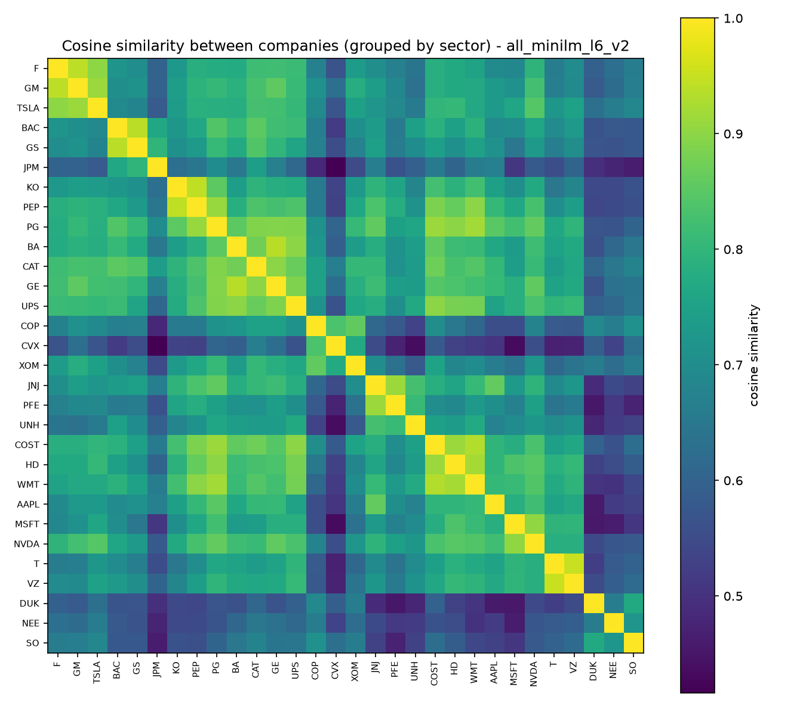
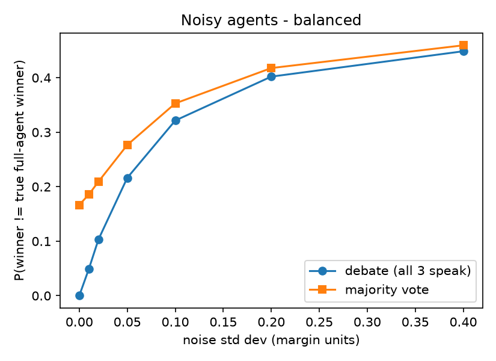

# Company Debate

**Can three AI agents who each see only one perspective — Finance, ESG, Risk — debate their way to the
same answer an all-seeing agent would reach? And what happens when that guarantee breaks?**

A pipeline that turns real companies into embeddings, learns one "direction" per perspective from real
labels, and runs an actual multi-agent debate engine over real SEC filings to pick the best company for
a given investor — tested honestly, compared against baselines, and stress-tested where the easy
guarantee stops holding.

📄 **[reports/EXPLAIN.md](reports/EXPLAIN.md)** — talk script, glossary, Q&A (start here)
📊 **[reports/RESULTS.md](reports/RESULTS.md)** — every number this run produced, with sources

---

## The idea

1. Represent each company as a point in space — an **embedding**, built from its actual SEC 10-K filing
   text via a pretrained sentence-embedding model.
2. Represent each perspective (Finance / ESG / Risk) as a **direction** — an arrow in that same space,
   learned from real labels so that projecting a company onto the arrow gives its score on that
   perspective.
3. An **investor** is just a set of weights (β) on the three perspectives — how much they personally
   care about each one.
4. The **full agent** combines all three directions with an investor's weights and can score any company
   directly. Three **partial agents**, each knowing only its own perspective, debate instead — taking
   turns, accumulating "evidence," until the sign decides a winner.
5. Because the scores are linear, the debate's winner is *mathematically guaranteed* to match the full
   agent's — once every agent has spoken. That's not a finding, it's algebra:

   ```
   m_F + m_E + m_R  =  S_ALL(B) − S_ALL(A)
   ```

   The real research question only shows up once that clean setup is broken on purpose — noise, a
   missing agent, cutting the debate short. That's what Phase 8 tests.

## Pipeline

```
30 real companies (10 sectors)
        │
        ▼  SEC EDGAR 10-K (Item 1 + Item 1A), rate-limited & cached
   raw filing text
        │
        ▼  sentence-transformers/all-MiniLM-L6-v2, chunked + mean-pooled + L2-normalised
   company embeddings  ──────────────┐
        │                            │  sanity-checked: nearest neighbours,
        ▼                            │  PCA map, similarity heatmap
   Finance / ESG / Risk labels       │
   (Yahoo Finance + Sustainalytics)  │
        │                            │
        ▼  L2-regularised logistic regression on pairs, nested CV (companies held out, not pairs)
   one direction per perspective  +  agreement matrix G
        │
        ▼  investor weights β (presets, or your own 18-pair questionnaire)
   full agent  +  3 partial agents
        │
        ▼  debate_pair() / tournament() — engine.py
   worked debate trace  +  30-company tournament  +  baselines
        │
        ▼  noise / missing-agent / early-stopping
   stress tests
```

## Key results (this run — see [RESULTS.md](reports/RESULTS.md) for full detail and sources)

**Embeddings capture real similarity.** Nearest-neighbour check: a company's closest match by cosine
similarity is same-sector 93.3% of the time, vs. a 7.1% random baseline.

|  |  |
|---|---|

**Directions beat chance, tested honestly (companies held out, never pairs):**

| Perspective | Held-out pair accuracy | Held-out Spearman ρ |
|---|---|---|
| Finance | **86.2%** | 0.613 |
| ESG | **84.0%** | 0.732 |
| Risk | **74.8%** | 0.452 |

**Agreement matrix G** (real, learned — ESG and Risk are natural challengers; Finance sits mildly
positive with both):

|   | Finance | ESG | Risk |
|---|---|---|---|
| **Finance** | 1.00 | +0.19 | +0.14 |
| **ESG** | +0.19 | 1.00 | **−0.16** |
| **Risk** | +0.14 | −0.16 | 1.00 |

**One real debate** (balanced investor, β = 0.40/0.35/0.25), full trace in
[`outputs/debate_trace_balanced.txt`](outputs/debate_trace_balanced.txt):

```
Debate: A=NVDA vs B=VZ
  speaker 1: Finance  margin -0.0599  running -0.0599  (highest weight speaks first)
  speaker 2: Risk     margin +0.0430  running -0.0170  (strongest challenger of Finance, G=+0.14)
  speaker 3: ESG      margin -0.0003  running -0.0173  (remaining agent)
  final evidence -0.0173  =>  NVDA wins, VZ eliminated
  identity check: m_F+m_E+m_R = -0.0173  vs  S_ALL(VZ)-S_ALL(NVDA) = -0.0173   OK
```

**Investors agree on the overall winner (MSFT) — but not on much else.** Finance-heavy and ESG-heavy
investors' full 30-company rankings only correlate at **Spearman 0.57** — genuinely different
priorities that happen to coincide at the very top (see [`investor_ranking_correlation.csv`](outputs/investor_ranking_correlation.csv)).

**Where the real findings are — the stress tests:**
- Under added noise, the full 3-agent debate is **consistently more accurate than majority voting**, at
  every noise level tested.
- Early stopping (skip speaking once the outcome can't change) saves **up to 33%** of agent messages for
  some investors — and **0%** for a "balanced" one, since its weights are too close together to lock in
  early. Winner never flips, for any investor, under any of the three bounds tested (0 mismatches).
- Dropping an agent hurts roughly in proportion to how much that investor weights it.



## Setup

```bash
python -m venv .venv --system-site-packages
.venv/Scripts/pip install scipy scikit-learn sentence-transformers requests beautifulsoup4 lxml yfinance seaborn joblib pytest
```
SEC requires a contact email in every request header:
```bash
export SEC_EMAIL=you@example.com     # or set CLAUDE_CODE_USER_EMAIL
```

## Run it

```bash
cd src
python run_all.py          # Phases 1-8: companies -> 10-K text -> labels -> embeddings -> sanity
                           # checks -> directions -> investor presets -> debate engine -> stress tests
```
10-K downloads and price/ESG data are cached on disk (`data/sec_cache/`, gitignored — ~172MB,
regenerate anytime), so a second run is much faster.

Add **your own** investor profile (18 pairwise picks, chosen because the perspectives disagree the
most on them — so your answers actually reveal something about your weights):
```bash
python p06_investor.py --interview
python p07_debate.py && python p08_stress.py   # re-run with your profile folded in
```

Tests (reproduces the whiteboard's exact numbers — margins +0.12/−0.04/+0.07, bracket
`{A,B,C,D}→{B,C,D}→{B,C}→B` — plus the identity, full-agent agreement, and early-stopping safety on
random worlds):
```bash
python -m pytest tests -q
```

## Project structure

```
src/                one file per phase (p01_companies.py ... p08_stress.py), plus:
  engine.py            the debate engine itself — directions, margins, speaker order, tournament
  directions.py        logistic / ridge / mean-difference direction fitting + nested CV
  common.py, config.py shared loaders, paths, seeds
data/
  companies.csv, labels.csv, investors.json, directions.npz
  raw_text/            extracted 10-K Item 1 / Item 1A text, one file per company per section
  embeddings/           .npy vectors for both models and all three text variants
outputs/              every plot, CSV and JSON this run produced (cited throughout the reports)
reports/
  EXPLAIN.md            talk script, glossary, step-by-step, Q&A, what's inferred vs. confirmed
  RESULTS.md             every number, with its source file
tests/test_engine.py  whiteboard reproduction + property tests on random worlds
PROGRESS.md           phase-by-phase log of what happened, what failed, what was assumed
DECISIONS.md          every default chosen without asking, and why
```

## Honest limitations

30 companies / 3 agents (a first pass, not full scale); ESG labels are a 2024 snapshot while
Finance/Risk are pulled live; perspective directions are shared across all investors (an assumption
from the whiteboard, not independently verified); with only 30 companies a real share of what each
direction learns is "which sector," not a finer distinction. Full list, with numbers, in
[RESULTS.md §7 and §9](reports/RESULTS.md) and [EXPLAIN.md §5](reports/EXPLAIN.md).

---

Built from a whiteboard brief (8 Oct 2026) for research under Prof. Mahesh Mohan M R and Kunal,
IIT Kharagpur — multi-agent LLM debate / "Financial Agentic AI Debate."
